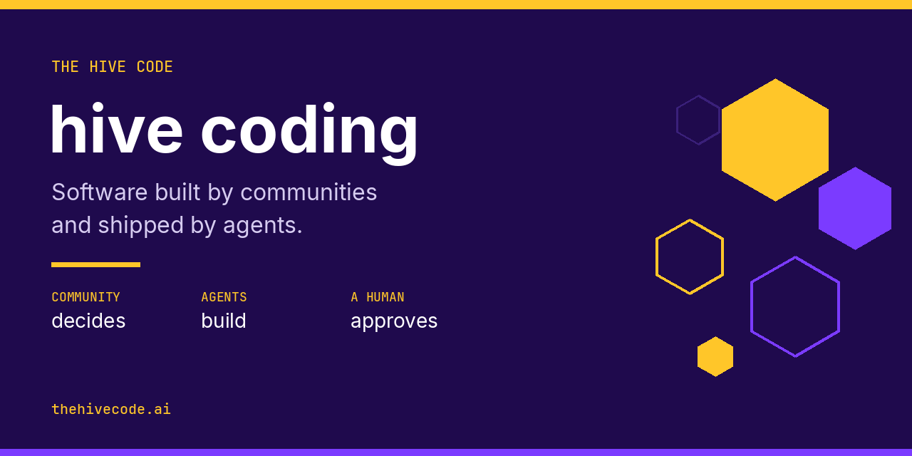

# Awesome Hive Coding

The public GitHub home for **hive coding**, maintained by [The Hive Code](https://thehivecode.ai/?ref=github).

> Hive coding is software built by communities and shipped by agents.

People suggest and vote on changes in public. An AI coding agent writes the code. A human reviews and merges it, so it ships with credit to the person who asked. In short: the community decides, agents build, humans approve.

The full definition, history, and FAQ are in [What is hive coding?](https://thehivecode.ai/learn/what-is-hive-coding?ref=github). This page is the linkable summary, plus the [HIVE.md](templates/HIVE.md) template and the [`thehivecode`](packages/cli) CLI.

Hive coding is also written **hivecoding** and **hive-coding**. "We hive-coded the booking page." Someone who takes part is a **hive coder**. On The Hive Code, members are **hivers**.

It is not [Apache Hive](https://hive.apache.org/), the Hive blockchain, or Hive AI.

## Contents

- [What it is](#what-it-is)
- [How it differs](#how-it-differs)
- [The hive loop](#the-hive-loop)
- [Make a repo hive-ready](#make-a-repo-hive-ready)
- [Where the term comes from](#where-the-term-comes-from)
- [Resources](#resources)
- [Contributing](#contributing)

## What it is

Three roles, from [What is hive coding?](https://thehivecode.ai/learn/what-is-hive-coding?ref=github):

| Role | Who | What they do | What they never do |
| --- | --- | --- | --- |
| The hive | Users, fans, idea people, anyone who cares | Suggest changes, vote, discuss, test what ships | Push code straight to the product |
| The agent | An AI coding agent | Turn an approved request into a pull request | Decide what to build, or merge its own work |
| The human | A maintainer or lead builder | Approve requests, review the agent's work, merge it | Hand the merge button to the crowd or the bot |

The hive brings direction, the agent brings speed, the human brings judgment. Remove the hive and you have plain agentic coding. Remove the agent and you have a feedback board. Remove the human and you have a security incident waiting to happen.

Words such as hiver, Honey, momentum, Shipped mark, and loop board are defined in the [hive coding glossary](https://thehivecode.ai/learn/hive-coding-glossary?ref=github). Honey, ranks, the loop board, and bounty builds are planned on The Hive Code, not live yet. The glossary marks which is which.

## How it differs

From [What is hive coding?](https://thehivecode.ai/learn/what-is-hive-coding?ref=github) and [Hive coding vs vibe coding](https://thehivecode.ai/learn/hive-coding-vs-vibe-coding?ref=github):

| | Who decides what to build | Who writes the code | Who approves it | Typical scale |
| --- | --- | --- | --- | --- |
| Vibe coding | One person | An AI model | Often nobody | One person, one app |
| Agentic coding | An engineer or a team | AI agents | The engineer | A team |
| Swarm coding | One person | Many AI agents in parallel | That person | One person, many agents |
| Open source | Maintainers and contributors who code | Human contributors | Maintainers | Anyone who can code |
| Crowdsourcing | A crowd, ideas only | Whoever the company hires | The company | Large crowds, closed build |
| Hive coding | The community, by public vote | AI agents | A human maintainer | Anyone who can type a sentence |

**Vibe coding** is one person prompting an AI and often accepting the result without reading it. Andrej Karpathy coined it on 2 February 2025. Simon Willison's useful narrowing: building with an LLM without reviewing the code it writes. Vibe coding answers "can I build this?" Hive coding answers "what should we build next, and who gets credit?" Most hive coding projects start as something one person vibe coded. They are not rivals. The longer comparison is [Hive coding vs vibe coding](https://thehivecode.ai/learn/hive-coding-vs-vibe-coding?ref=github).

**Swarm coding** is one person running many AI agents in parallel. Hive coding flips the ratio: many people and many AIs. A crowd prompting agents with no review is not hive coding.

**HiVE coding**, as DevSwarm uses it, means High Velocity Engineering: a team practice for shipping fast with AI, with the engineer in control. That is closer to agentic engineering than to the community meaning on this page. [The Hive Code](https://thehivecode.ai/?ref=github) uses the community meaning.

**Agentic engineering** is Karpathy's name for a skilled person orchestrating agents and acting as oversight. Hive coding uses those habits on the maintainer's side. What it adds is the hive: a public, voting community that chooses the work and gets credit for it.

**Community coding** usually means people building software together: open source, a club, a hack day. In open source the people who take part are, in practice, people who write code. Hive coding is a community of anyone. Agents do the typing. A human still holds the merge button. Open source is the ancestor, not the same practice. The catch with classic open source was that most users could only file an issue and hope. See [The Cathedral and the Bazaar](https://en.wikipedia.org/wiki/The_Cathedral_and_the_Bazaar) and [Building community](https://opensource.guide/building-community/) from the Open Source Guides.

**Pair programming** is two people on one task at the same time, one typing and one reviewing, as [Birgitta Böckeler and Nina Siessegger describe it](https://martinfowler.com/articles/on-pair-programming.html). Hive coding is not a pairing session. The community chooses the work asynchronously, an agent writes the change, and a maintainer reviews it before merge. A maintainer can still pair with someone on that review.

**Crowdsourcing** generates ideas at scale. Someone still has to build them. Jeff Howe named it in Wired in June 2006. Hive coding is what that looks like once an agent can draft the change and a human still decides what ships.

## The hive loop

Hive coding runs on a five-step loop. The walkthrough, including what fails at each step, is [How the hive coding loop works](https://thehivecode.ai/learn/hive-coding-loop?ref=github).

| Step | Who acts | What comes out |
| --- | --- | --- |
| 1. Suggest | Anyone in the hive | A public suggestion, a problem and a result |
| 2. Vote | The hive | A ranked queue. Votes inform the maintainer. They do not bind them. |
| 3. Agent builds | Maintainer, then agent | A pull request for an accepted suggestion |
| 4. Human merges | Maintainer | A merged change, or a "not yet" |
| 5. Ships | Everyone | A live change, with credit to the person who asked |

Then it starts again. The loop is public.

Rules that keep it from turning into "strangers steer a bot":

1. Humans merge. No agent merges its own work, and no vote merges anything.
2. Requests, not commands. Community text reaches an agent only after a human approves it, as a clearly labeled quoted request. The maintainer writes the spec.
3. The queue is public. If people cannot see what is being built and why, it is not hive coding.
4. Credit always. Every ship names the person who asked.
5. Credit, not ownership. Posting an idea does not reserve it, and it does not hand out equity.
6. Small changes ship. One suggestion, one pull request.

You can run this by hand with Discord, GitHub, and any agent that turns an issue into a pull request. The step-by-step is [How to hive code your first project](https://thehivecode.ai/learn/how-to-hive-code-your-first-project?ref=github). Protect `main` before an agent touches the repo.

On [The Hive Code](https://thehivecode.ai/?ref=github), live today: accounts, the [idea board](https://thehivecode.ai/ideas?ref=github), and [projects](https://thehivecode.ai/projects?ref=github) where people try a public repo and leave feedback. A maintainer can mark feedback Shipped and credit the author. Coming next: the suggestion board, agents that build approved suggestions, Honey and ranks, and bounty builds. [How an idea becomes a hive](https://thehivecode.ai/learn/how-an-idea-becomes-a-hive?ref=github) is the path from a post to a build.

## Make a repo hive-ready

[HIVE.md](https://thehivecode.ai/learn/hive-md?ref=github) is a short file at the root of a repo. It says what the project is, who it is for, what help it wants, and how to run it. A repo with a valid HIVE.md is hive-ready.

On The Hive Code it fills in a listing, earns the Hive-ready badge, and powers "Use this" (the run steps, and one-click deploy buttons for Vercel or Netlify). You do not need one to list a public repo. It is free to use anywhere, including projects that never list on The Hive Code.

The platform reads only the header fields, checks each one, and shows them as plain text. It never runs the commands, follows instructions in the file, or lets the file change what an agent does. Keep the license in `LICENSE`. The Hive Code reads that from GitHub.

All fields are optional. Limits are inclusive.

| Field | What to write | Limit |
| --- | --- | --- |
| `tagline` | What it is, in one line | 10 to 120 characters |
| `for` | Who it is for | 3 to 80 characters |
| `problem` | The problem it solves | 10 to 200 characters |
| `help_wanted` | What help you want right now | Up to 200 characters |
| `run` | Commands to run it on your own computer | Up to 20 lines |
| `deploy` | `vercel`, `netlify`, or both | |

This is the template from that guide:

```markdown
---
tagline: Booking for barbers that texts the waitlist when a chair opens
for: Barbers and small salons
problem: Chairs sit empty when a client cancels late
help_wanted: A tester with a real shop, and someone for the waitlist texts
run: |
  npm install
  npm run dev
deploy: [vercel]
---

# Chair Alert

Say more here in your own words: what it does today, what is next, and how to help.
```

A commented copy is in [`templates/HIVE.md`](templates/HIVE.md). Filled examples, marked as examples and not live products:

- [A web app](templates/examples/web-app.md)
- [A game](templates/examples/game.md)
- [A CLI](templates/examples/cli.md)

HIVE.md is not [AGENTS.md](https://agents.md/). AGENTS.md is instructions for a coding agent. HIVE.md is a description for people, and for a listing. Nothing in it is an instruction to an agent.

### CLI

[`thehivecode`](packages/cli) writes and checks a HIVE.md. It has no runtime dependencies. It is not on npm yet. Until it is published, run it from a checkout:

```bash
node packages/cli/bin/thehivecode.js init
node packages/cli/bin/thehivecode.js check
```

After publish, the same commands are `npx thehivecode init` and `npx thehivecode check`. The publish steps are in [PUBLISHING.md](PUBLISHING.md). Do not publish from a fork.

`init` asks a few questions and writes `HIVE.md`. Defaults come from the folder name and, when it is useful, `package.json`. `--yes` accepts the defaults and will not replace an existing file unless you also pass `--force`.

`check` lints the header against the limits above and prints a hive-ready score from 0 to 100. The file is hive-ready when it parses and every field you set is within the limits. The score is how many of the recommended fields are filled in. `deploy` is optional and is not part of the score. The command never runs `run`.

```bash
node packages/cli/bin/thehivecode.js check --json
node packages/cli/bin/thehivecode.js --help
```

## Where the term comes from

Nobody owns the term. [The Hive Code](https://thehivecode.ai/?ref=github) did not invent it. This is the timeline from [What is hive coding?](https://thehivecode.ai/learn/what-is-hive-coding?ref=github), with the pages those credits point at.

- **September 2025.** [Mike Biglan at DevSwarm](https://devswarm.ai/blog/high-velocity-engineering-hive-coding-vs-vibe-coding/) published "HiVE Over Vibe" on 19 September 2025. HiVE coding there means High Velocity Engineering, a production discipline for engineers running parallel AI assistants. It is about speed and quality inside a team, not crowd-directed building.
- **April 2026.** [Owen Barnes's hackathon project](https://github.com/owenb/hivecode) describes itself as "You've heard of vibe coding.... this is hive coding. Co-create socially." It was a shared canvas where people and an AI design pages together. His team won first prize and the Google DeepMind prize at a Tech:Europe hackathon. He records that on [his ventures page](https://www.owenbarnes.com/ventures).
- **10 October 2026.** [Max Blade](https://x.com/_MaxBlade/status/2108964638255690238) posted that hivecoding, for him, was livestream chat directing a team of AI agents on his game, Kong Royale. [The Open Letter covered the post](https://theopenletter.io/p/hivecoding-max-blade). The game's site is [kongroyale.com](https://kongroyale.com/).
- **12 October 2026.** [Wavect's glossary](https://wavect.io/glossary/hivecoding/) defined hivecoding as an informal approach where a community suggests features, AI agents prepare code changes, and developers decide what ships.

Owen Barnes used the phrase for social co-creation first that we can find, and Max Blade made hivecoding a thing people talk about. The shared core is: a crowd directs, agents build. The Hive Code's role is a home where any project, not one stream or one game, can run the loop in public.

## Resources

Every link below was opened while this page was written. Descriptions say what the page is. They do not add counts.

### Definitions

- [What is hive coding?](https://thehivecode.ai/learn/what-is-hive-coding?ref=github) — definition, the three roles, history, and FAQ.
- [Hive coding vs vibe coding](https://thehivecode.ai/learn/hive-coding-vs-vibe-coding?ref=github) — side-by-side comparison, and when each one fits.
- [How the hive coding loop works](https://thehivecode.ai/learn/hive-coding-loop?ref=github) — suggest, vote, agent builds, human merges, ships.
- [How an idea becomes a hive](https://thehivecode.ai/learn/how-an-idea-becomes-a-hive?ref=github) — backers, momentum, and a lead builder.
- [How to hive code your first project](https://thehivecode.ai/learn/how-to-hive-code-your-first-project?ref=github) — the manual loop with Discord, GitHub, and a coding agent.
- [Hive coding glossary](https://thehivecode.ai/learn/hive-coding-glossary?ref=github) — plain-English definitions, with planned features marked.
- [HIVE.md](https://thehivecode.ai/learn/hive-md?ref=github) — the file format and the template.
- [llms.txt](https://thehivecode.ai/llms.txt?ref=github) — a short machine-readable summary of the same facts.

### Earlier uses and neighboring terms

- [Andrej Karpathy's vibe coding post](https://x.com/karpathy/status/1886192184808149383) — 2 February 2025. The post that named vibe coding.
- [Collins on vibe coding as its 2025 Word of the Year](https://blog.collinsdictionary.com/language-lovers/collins-word-of-the-year-2025-ai-meets-authenticity-as-society-shifts/) — the dictionary's own note. [The Guardian reported the choice](https://www.theguardian.com/technology/2025/nov/06/vibe-coding-collins-dictionary-word-of-the-year-2025).
- [Simon Willison: not all AI-assisted programming is vibe coding](https://simonwillison.net/2025/Mar/19/vibe-coding/) — vibe coding means not reviewing the code the model writes.
- [India Today on agentic engineering](https://www.indiatoday.in/technology/news/story/vibe-coding-era-over-ai-guru-who-coined-the-term-says-time-has-come-for-agentic-engineering-now-2863387-2026-02-05) — Karpathy's February 2026 name for orchestrating agents, with a person as oversight.
- [HiVE Over Vibe](https://devswarm.ai/blog/high-velocity-engineering-hive-coding-vs-vibe-coding/) — DevSwarm, 19 September 2025. The other meaning of the word.
- [owenb/hivecode](https://github.com/owenb/hivecode) — Owen Barnes, April 2026, social co-creation with an AI on a shared canvas.
- [Max Blade's 10 October 2026 post](https://x.com/_MaxBlade/status/2108964638255690238) — livestream chat directing agents. [The Open Letter's write-up](https://theopenletter.io/p/hivecoding-max-blade).
- [Wavect: What is Hivecoding?](https://wavect.io/glossary/hivecoding/) — a glossary entry from 12 October 2026, in the community-led sense.

### Agents that can prepare a change

The loop does not depend on one product. Any agent that can take an approved request and return a diff fits. A human still merges. These are the ones whose own docs match a step in that loop:

- [Claude Code](https://code.claude.com/docs/en/overview) and the [Claude Code GitHub Action](https://code.claude.com/docs/en/github-actions) — the docs describe turning issues into pull requests. The action's repository is [anthropics/claude-code-action](https://github.com/anthropics/claude-code-action).
- [Starting a GitHub Copilot cloud agent session](https://docs.github.com/en/copilot/how-tos/use-copilot-agents/cloud-agent/start-copilot-sessions) — sessions can start from an issue. Some entry points open a pull request; a person reviews it. Background: [Copilot on GitHub.com](https://docs.github.com/en/copilot/concepts/copilot-surfaces/copilot-on-github).
- [Cursor cloud agents](https://cursor.com/docs/cloud-agent) — Cursor's docs: run an agent in the cloud for coding assistance.
- [OpenAI Codex](https://github.com/openai/codex) — a coding agent that runs in the terminal. The maintainer still reviews what it changes.
- [Aider](https://aider.chat/) — AI pair programming in the terminal. One person stays in the loop. Repository: [Aider-AI/aider](https://github.com/Aider-AI/aider).
- [goose](https://goose-docs.ai/) — an open-source, extensible AI agent that can install, edit, execute, and test. Repository: [aaif-goose/goose](https://github.com/aaif-goose/goose). The older docs host redirects here.
- [AGENTS.md](https://agents.md/) — a plain-Markdown convention for instructions to coding agents. Useful next to a HIVE.md, and a different file. Do not put agent instructions in HIVE.md.

DevSwarm's desktop app runs parallel, branch-isolated assistants for the HiVE meaning above. It is listed with that essay, not as a hive coding tool.

### Review and merge safety

- [About protected branches](https://docs.github.com/en/repositories/configuring-branches-and-merges-in-your-repository/managing-protected-branches/about-protected-branches) — require a pull request and a review before `main` moves.
- [Veracode on security risks in AI-generated code](https://www.veracode.com/blog/ai-generated-code-security-risks/) — why a human merge is a step, not a courtesy. The Learn pages cite their 2025 study.
- [Linux kernel: submitting patches](https://docs.kernel.org/process/submitting-patches.html) — `Suggested-by:` credits the person who asked. [AI coding assistants](https://docs.kernel.org/process/coding-assistants.html) — humans sign off, and AI help is credited with `Assisted-by:`.
- [OWASP Top 10](https://owasp.org/projects/top-ten) — the usual web risks to look for in a review.
- [OWASP: prompt injection](https://genai.owasp.org/llmrisk/llm01-prompt-injection/) — hiding instructions inside text a model will read. Hive coding treats community text as a quoted request a human has approved.
- [About secret scanning](https://docs.github.com/en/code-security/concepts/secret-security/secret-scanning) — agents should not have production keys, and secrets should not land in the repo.

### Community-driven development

- [Open Source Guides](https://opensource.guide/) — how to run a public project. [Building community](https://opensource.guide/building-community/) is the closest chapter.
- [The Cathedral and the Bazaar](https://en.wikipedia.org/wiki/The_Cathedral_and_the_Bazaar) — Eric S. Raymond on development in public. Hive coding keeps the public part and adds agents plus a human merge.
- [The Rise of Crowdsourcing](https://www.wired.com/2006/06/crowds/) — Jeff Howe, Wired, June 2006.
- [On pair programming](https://martinfowler.com/articles/on-pair-programming.html) — Birgitta Böckeler and Nina Siessegger. The practice people sometimes confuse with a hive.
- [GitHub Discussions quickstart](https://docs.github.com/en/discussions/quickstart) — a public place for suggestions if you are not using Discord.
- [Discord forum channels](https://discord.com/blog/forum-channels-space-for-organized-conversation) — the channel type the first-project guide uses as a loop board, with tags for Open, Accepted, Building, Shipped, and Declined.

There is no conference talk in this list. We did not find one whose page we could describe without guessing. If you have one, open an issue.

## Contributing

See [CONTRIBUTING.md](CONTRIBUTING.md) and the [code of conduct](CODE_OF_CONDUCT.md). The short version: open the link before you add it, keep definitions aligned with the Learn pages, and do not invent numbers.

To suggest a resource, use the [Add a resource](.github/ISSUE_TEMPLATE/add-a-resource.yml) issue form.

## License

[MIT](LICENSE). The HIVE.md format is free to use on The Hive Code or anywhere else.

[The Hive Code](https://thehivecode.ai/?ref=github) · [Learn hive coding](https://thehivecode.ai/learn?ref=github) · [Post an idea](https://thehivecode.ai/ideas?ref=github) · [Try a project](https://thehivecode.ai/projects?ref=github) · [support@thehivecode.ai](mailto:support@thehivecode.ai)
